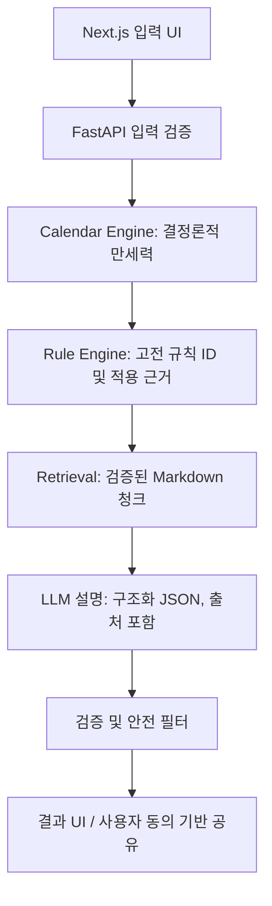

# 아키텍처 설계

- 프런트: Next.js TypeScript Tailwind; React Hook Form+Zod 선택. 백엔드: FastAPI/Pydantic. PostgreSQL은 공유 링크 기능에만, 원본 출생정보 저장 기본 OFF.
- 만세력 모듈: AI 호출 없이 계산 가능한 독립 패키지. 태양력/음력/윤달/표준시/절기/야자시/경도·균시차 프로필을 **명시적 설정**으로 계산. 계산기 버전, 절입 근거, IANA timezone, DST 적용 기록.
- 규칙: `rule_id`, 고전/주석 저자, 장절, 인용, 적용/제외 조건, 모순 규칙, 판정 근거, source URL. 격국용신/억부용신/조후용신 별도.
- LLM 입력: 결정론적 facts + 연결된 rule_ids + 관련 원문 발췌. 출력 schema validation+근거 없는 사실 제거. 정확한 운세 예측, 건강진단, 특정 투자 권유 금지.
- 공유: 개인정보 가림 기본, 서버측 랜덤 토큰/만료/회수, 링크 인덱싱 차단, 분석 로그에서 입력 제거, rate limit, CSRF/XSS 방어.

## API 계약 (목표)
POST /api/v1/calendar/calculate -> `{pillars, options, ambiguous, provenance}`
POST /api/v1/interpretations -> `{summary, domains, references, disagreements, disclaimer}`
POST /api/v1/shares -> `{share_url, expires_at}` (사용자 명시 동의)
DELETE /api/v1/shares/{id} -> 204
GET /api/v1/health -> `{status}`
실제 backend 기본형은 API 골격만 제공하며 **계산은 501**로 막음.
