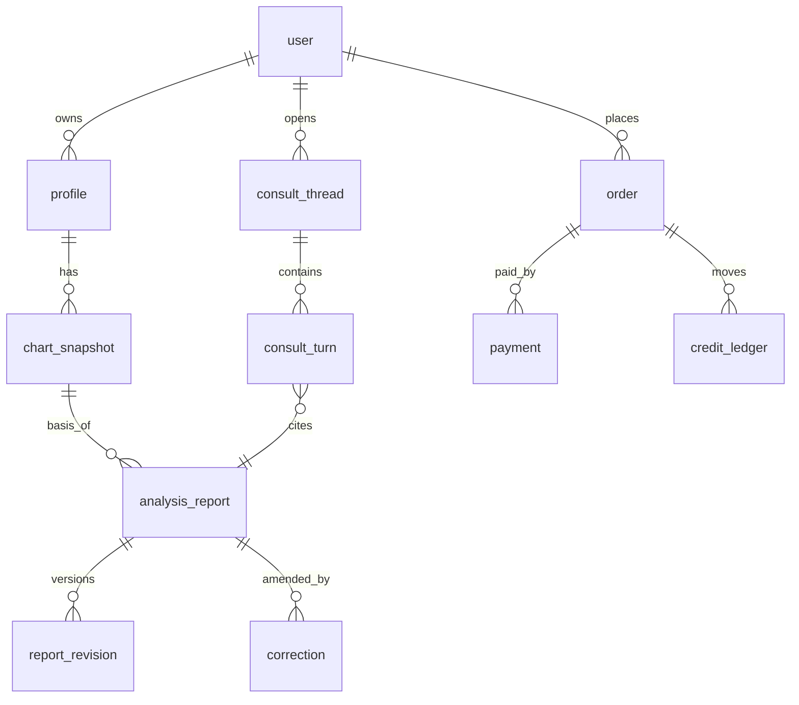

# 사용자·명식·분석·상담 데이터 모델

관계형 DB(PostgreSQL) 기준. 모든 테이블 `id uuid`, `created_at`, `deleted_at(soft delete 후 하드 삭제 잡)`.

## 핵심 테이블
| 테이블 | 주요 컬럼 | 비고 |
|---|---|---|
| user | email_hash, auth_provider, status, consent_version, free_quota_used | 이메일 원문은 암호화 컬럼, 검색은 hash |
| profile | user_id, label(별칭), gender, birth_enc(암호화 블롭), place_code, calendar, is_leap, time_known | 출생정보는 **앱 레벨 암호화**(envelope key). 이름·연락처는 받지 않음. 가족 4인 입력은 profile 4행 |
| chart_snapshot | profile_id, **input_hash**, calculation_profile_id, engine_version, ephemeris, variants(json), verification(json: status, levels, v1_blockers), created_at | 계산 결과 불변. 같은 input_hash+profile 이면 재사용(계산 비용 0) |
| analysis_report | chart_snapshot_id, variant_id, product_code, depth(summary/detailed/expert), scope(json: years, domains, compare), ruleset_version, model_version, prompt_version, status(queued/running/succeeded/failed/withdrawn), content_ref(object storage), content_hash, cost_json | **precommit**: 구조 분석 JSON 은 상담 시작 전에 생성·해시 고정 |
| report_revision | report_id, rev_no, reason(correction/regen), diff_ref, published_at | 원본은 삭제하지 않고 정정본을 추가 |
| correction | report_id, reported_by, category(calc/rule/text/safety), status, resolution, notified_at | 오류 발견 시 구매자 고지 의무 |
| consult_thread / consult_turn | user_id, report_id, role, text_enc, **kind**(question/reality_input/answer), cited_claim_ids | 현실 입력(reality_input)은 명식 계산·구조 JSON 에 접근 불가(분리 저장) |
| order / payment / credit_ledger / entitlement | 07 문서 참조 | |
| audit_log | actor, action, target, ip_hash, at | 개인정보 값 미기록 |
| llm_usage | report_id, stage, model, in_tokens, out_tokens, latency_ms, cost_micro, cache_hit | 06 문서 |

## 분리 원칙
- **구조 분석(결정론적)** 과 **LLM 설명(생성)** 은 별도 산출물. 설명은 구조 JSON 의 `claim_id` 만 인용하고 새 사실을 만들지 못한다.
- **현실 상황 입력**은 상담 턴에만 저장, `analysis_report.structure_ref` 를 바꾸지 않는다(사후 끼워 맞추기 방지).
- 변형 명식(`variants`)이 있으면 report 는 `variant_id` 를 반드시 기록하고, 사용자에게 변형 존재를 고지한다.
